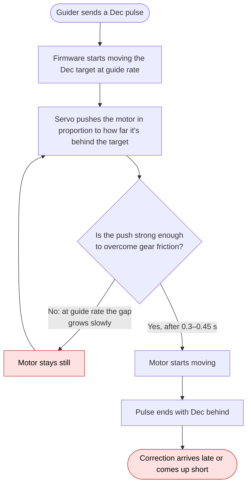
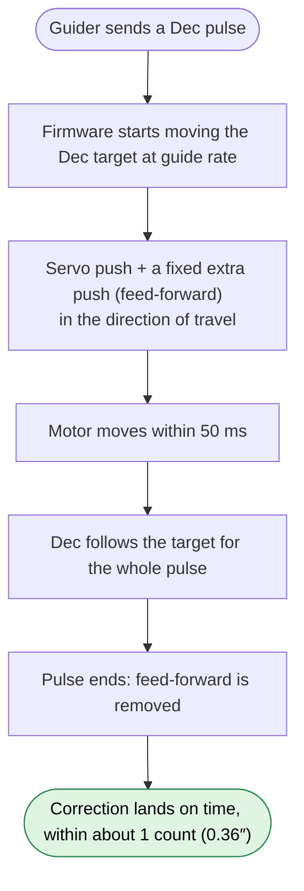
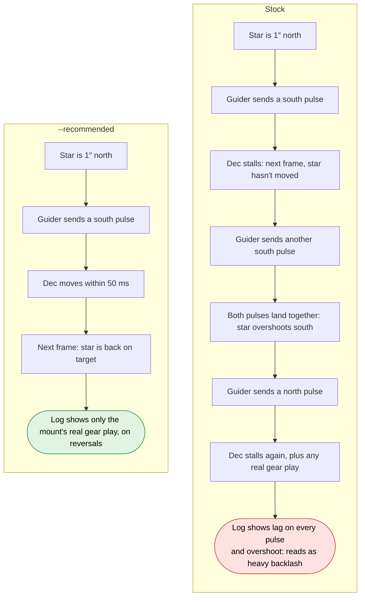
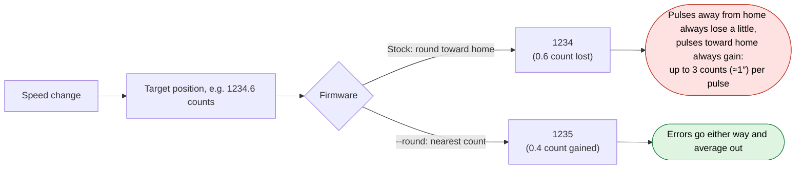
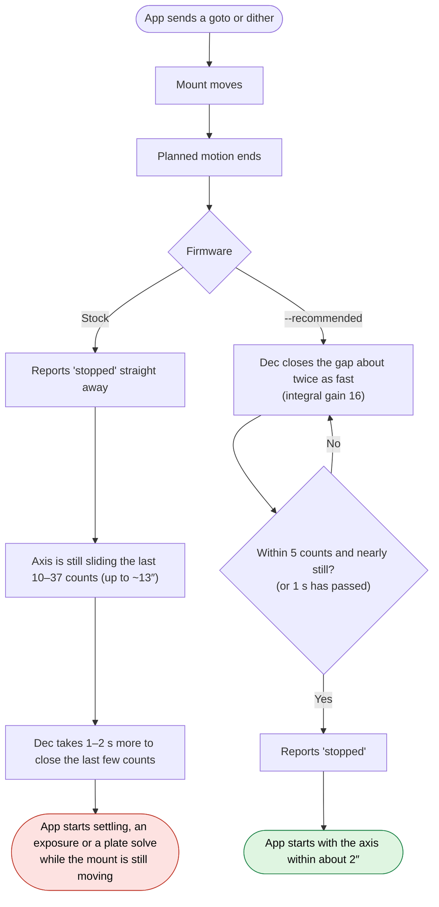
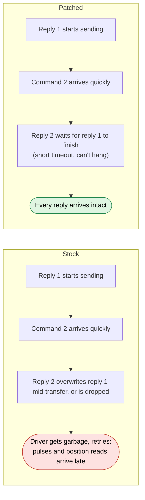

# Tracking and guiding: before and after

This page shows how the mount behaves during guiding and after a goto, with the stock v3.48
firmware and with a `--recommended` build. It's for readers who want to know what the fixes
change in practice, not how they're made.

> [!NOTE]
> The measured numbers here come from the [Results](README.md#results) section of the README
> (bare mount, over USB). Anything about how guiding software reacts is explanation, not
> measurement.

## Why it looks like backlash

Backlash is play in the gears: when an axis reverses, the motor turns for a moment before the
gears engage and the sky moves. In a guiding log it shows up as Dec corrections that do
nothing for a while, then overshoot, usually right after a change of direction.

Several v3.48 firmware bugs produce the same pattern, so guiding problems on this mount are
easy to put down to backlash. The firmware ones have a giveaway, though:

| What you see | Usually blamed on | What the stock firmware is doing | Fix in `--recommended` |
| --- | --- | --- | --- |
| Dec corrections do nothing at first, then arrive late | Backlash | Dec doesn't move for 0.3–0.45 s at the start of **every** pulse, same direction or not | Dec feed-forward |
| The guider keeps pushing Dec, then overshoots | Backlash, aggressiveness too high | Late pulses pile up: the guider sends more, then all of them land | Dec feed-forward |
| North pulses and South pulses (or East and West) move different amounts | Backlash, balance | The target is rounded toward home at each speed change, gaining or losing up to 3 counts per pulse | `--round` |
| Drift right after a goto, dither or meridian flip; plate solve slightly off | Backlash, settling | The mount says "stopped" while the axis is still sliding up to ~13″ | `--in-position 5`, Dec integral gain 16 |
| Occasional missed or erratic corrections over USB | Cable, USB port | Replies get garbled and the driver has to retry | USB fix |

**The quick test:** real backlash only appears when an axis **reverses**. The Dec stall in
v3.48 appears at the start of **every** Dec move, including two pulses in the same direction.
If a guiding log shows the same lag on same-direction pulses, it isn't (only) backlash.

The patches don't remove mechanical backlash. If your gears have play, you'll still see it on
reversals. But a mount that was measured as having a lot of backlash may turn out to have much
less once the firmware stops adding its own.

## A Dec guide pulse

### Stock



### With `--recommended`



### On a timeline

A 500 ms pulse at 0.5× sidereal asks for about 3.8″ (about 10 counts):

```
Guide pulse      |================ 500 ms ================|
                 0         100        200        300        400        500 ms

Stock Dec        |------- still for 300–450 ms ------|>>>>>>>>>   (late, and short)
Patched Dec      |>>>>>>>>>>>>>>>>>>>>>>>>>>>>>>>>>>>>>>>>>>|   (moves within 50 ms)
```

On stock, most of a short pulse has passed before Dec moves at all. Short corrections, the
ones a well-tuned guider sends most often, are hit hardest.

## What the guider sees

This is what happens between the guide camera and the mount over several frames. Stock on the
left, `--recommended` on the right.



Tools that measure backlash by pushing Dec one way and then back, such as a guiding
assistant, can't tell the stall from gear play, so on stock firmware they're likely to report
more backlash than the gears really have. If you set Dec backlash compensation on stock
firmware, it may over-correct after the patch. Measure again after flashing.

## Uneven pulses in opposite directions (`--round`)

Inside the firmware, a guide pulse has about four changes of speed: start, guide rate, end,
back to tracking. At each one the firmware restarts its internal target from a whole number of
encoder counts.



On stock, one direction of guide pulse consistently moves the mount further than the other.
This affects RA as well as Dec. A guider sees it as one direction being "stiffer", which is
easy to blame on balance or backlash. In ConformU's pulse-guide tests, the East/West difference
dropped from about 3.5 counts to under 1, and North/South from about 2.5 to 1.5.

## After a goto, dither or flip (`--in-position 5` and Dec integral gain 16)



On stock, the first guide frames after a dither or flip see the star still drifting into
place. The guider tries to correct a move that's already finishing, which looks like poor
settling or backlash. With the patch, "stopped" is reported 0.1–1.0 s later than stock, but
it's true when it arrives.

## Commands over USB



This isn't a guiding bug as such, but retries delay pulses and position reads at random,
which adds to the mess in a guiding log. It's why many owners find an EQMOD cable on the
hand-controller port works better than USB on stock firmware. With the patch: 0 bad replies in
over 70,000 commands.

## What doesn't change

- **Mechanical backlash.** Gear play is still there and still shows on reversals.
- **RA tracking.** The feed-forward and integral gain changes are Dec only. RA is affected
  only by `--round` (more even E/W pulses) and `--in-position` (when "stopped" is reported).
- **Balance, polar alignment, seeing, flexure.** These still matter as much as they did.
- **At rest.** Feed-forward is only applied while Dec is moving. Dec held still in testing.

## After flashing

1. Re-run your guiding software's calibration. Dec now responds sooner, so the measured
   rate may change.
2. Measure backlash again before setting any Dec backlash compensation. Start from none.
3. If you'd raised Dec aggressiveness or minimum move to make up for the stall, try bringing
   them back towards the defaults.
